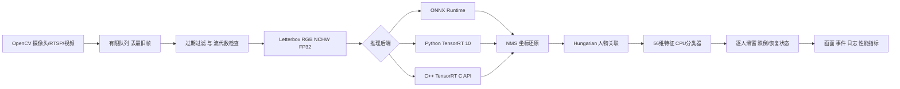
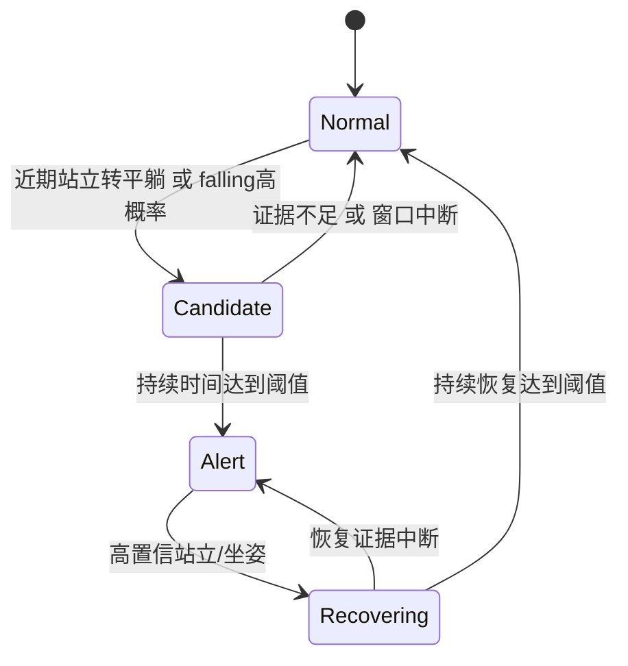

# 系统设计

## 边界与约束

- 推理后端只收连续 FP32 NCHW 张量，返回原始关键点输出和后端耗时，不管理人物状态。
- 跟踪 ID 在单次运行内递增；流重连清空 tracks，不复用上一段窗口。
- 人物窗口由媒体/实时单调时间控制，不能用“连续 N 帧”代替持续时间，丢帧时仍使用实际时间。
- 采集队列与时序窗口有容量上限，统计分位数最多保留 20000 个样本；日志会持续写磁盘。
- 捕获断连与推理故障有有限重试，模型契约/配置错误通过明确异常呈现；失败摘要仍保留到输出目录。
- 输出状态不作为训练真值，人工人物 ID 和类别构成数据集。

## 跌倒状态

平躺人体入场不会凭规则直接触发跌倒；低置信度 `unknown` 不产生候选。告警激活后持续平躺维持告警，避免每帧重复事件；身份过期或流切换后必须重新获得证据。

## 评估注意事项

模型精度应与 ONNX Runtime 基线、真实姿态分类和真实跌倒事件三层分别比较。raw 输出误差可能由低分 anchor 放大；报告因此同时提供后处理匹配误差。FP16 误差阈值需在固定代表性数据上预先确定。

connected component 划分比按帧随机划分更严格。相同人出现在多个视频、视频中有多人时，所有关联记录进入同一个 split，避免人物外观或同视频背景泄漏。若所有数据来自同一场景且人物互相关联，无法获得有效独立评估集，需重新采样。

时间戳匹配容差默认 50 ms。评估要求在所有预测帧上完整标注；稀疏标注时应先筛选对应预测帧，否则未标注帧的预测会计 FP。单目关键点不能保证可靠重识别，长遮挡需额外 re-ID 或更成熟 tracker。

